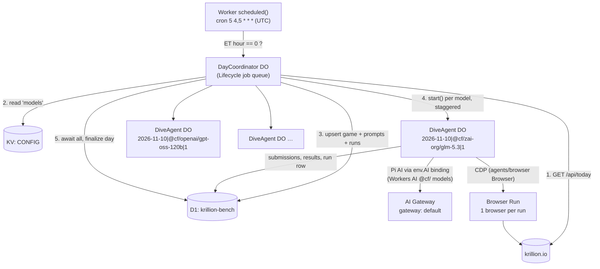

# krillion-bench — design

Daily benchmark: every model in a KV list plays the Krillion Daily Dive (https://krillion.io) through a real browser at midnight US Eastern. Browser use is part of what is measured. Results land in D1; a leaderboard frontend comes later and reads only D1.

## 0. Scope and account

- **Account:** `Adhi.thirumala@gmail.com's Account` (`b8a6047310bbd4b0a0e5374e91089308`). Everything (Worker, DOs, D1, KV, Browser Run) deploys there.
- **Models: Workers AI only for now.** Third-party providers (Anthropic, OpenAI, Gemini, …) and their keys/credits are deferred; the design keeps a slot for them (§6) but nothing depends on it.
- **Why that is simple:** Workers AI models go through `env.AI` with the account's existing `default` AI Gateway (authentication on, `workers_ai_billing_mode: postpaid`). No AI Gateway credits, no API keys, no secrets. Usage bills to the Workers plan.
- **Plan check:** entitlements look like Workers Paid (`d1.max_databases=1000000`, `containers.enabled=true`), but the subscriptions endpoint returned 403, so confirm in the dashboard. It matters: on Workers Free, Browser Run is 3 concurrent browsers and 10 browser-minutes/day, which can't run this benchmark.
- Existing resources in the account are unrelated (poker, 67dle, sisr, learnscrolling); this project adds its own D1 database `krillion-bench`, KV namespace `krillion-bench-config` (binding `CONFIG`), and Worker `krillion-bench`.
- **Public URL:** `https://krillion.agentfan.club`. The zone `agentfan.club` is in the *agent fan club* account, so a plain CNAME/A record to the Worker can't work (cross-account CNAMEs fail with error 1014; hostnames route to the account that owns the zone). Instead `krillion.agentfan.club` is a **Cloudflare for SaaS custom hostname on `realartists.work`** (personal account; fallback origin `saas.realartists.work`, proxied `AAAA 100::`), and the Worker has the route `krillion.agentfan.club/*` on that zone. The only records in agentfan.club: DNS-only `CNAME krillion → saas.realartists.work` and `TXT _cf-custom-hostname.krillion` (ownership). `/admin` there returns 403 (no Access app on that host); the admin portal stays on `krillion-bench.adhi-thirumala.workers.dev/admin`.
- **AI Gateway:** dedicated gateway `krillion-bench` (authentication on, logs on, cache off, `workers_ai_billing_mode: postpaid`), set via the `AI_GATEWAY` var. Workers AI models bill postpaid as before. Anthropic, OpenAI and Google AI Studio models use **BYOK keys stored on this gateway under the `default` alias**; the AI binding only consults that alias. Without a key the gateway falls back to unified billing and fails with 402 "Insufficient balance" (balance is $0), so those runs end `infra_error` with score 0. The roster carries every catalog model that answered a one-turn tool-call probe through the gateway on 2026-11-10: 14 Claude, 21 OpenAI, 17 Google (Gemini 3.x/4, Gemma 4). Dropped: `gpt-4.1-nano` (retired), `o3-mini`/`o4-mini` (no access on this key), `gpt-5.4-pro`/`gpt-5.5-pro` (3 RPM org limit: a dive needs far more), Gemini 2.5 (closed to new users), Deep Research (Interactions API only), Gemini 2.5 Computer Use (requires its own tool). Disabled: `google/gemma-4-31b-it` and `google/gemma-4-26b-a4b-it` (AI Studio Tier 1 caps Gemma at 16k input tokens/min; a dive exceeds it in the first minute). Provider rate limits as of 2026-11-10: Anthropic 4,000 RPM / 2M ITPM; OpenAI org on the Free tier (50 RPD, 3 RPM, 10k TPM on flagship models) despite $50 of credit purchases, escalated to OpenAI support. The admin picker lists every catalog model with its price.
- **Gemini route:** `agents/models/pi-ai` sends only Anthropic/OpenAI wire formats to the gateway, so roster ids `google/<id>` resolve (`src/agent/gateway.ts`) to Pi's Google catalog entry re-pointed at Google's OpenAI-compatible endpoint (`generativelanguage.googleapis.com/v1beta/openai`, which the gateway maps to `google-ai-studio`). A wrapper on the AI binding's gateway `fetch` fixes two incompatibilities: Gemini 3+ rejects replayed tool calls without their `thought_signature` (`extra_content.google`), which Pi drops, so signatures are captured by tool-call id from the stream and re-attached (Google's documented skip value if an isolate restart lost one); and streamed tool-call deltas carry no `index`, which would merge parallel calls.
- **Models newer than Pi's catalog:** `src/agent/gateway.ts` has two small tables. `GOOGLE_EXTRA` lists Gemini models Google serves that Pi AI 1.5.2 doesn't know (limits from Google's `models.get`; no published price, so cost records as $0): `gemini-4-carbon`. `CATALOG_EXTRA` lists AI Gateway catalog models Pi doesn't know, built as a copy of the nearest listed sibling under the vendor's id and sent over the provider-native path (BYOK pays): `anthropic/claude-fable-5.2` (copy of Fable 5.1, price assumed equal).
- **Full AI Gateway catalog check (2026-11-11):** every text-generation model on developers.cloudflare.com/ai/models that isn't in the roster got a one-call tool probe through `krillion-bench`. Only `anthropic/claude-fable-5.2`, `openai/gpt-5.4-pro` and `openai/gpt-5.5-pro` answered (the Pro models stay out: 3 RPM on the OpenAI Free tier). Every other provider in the catalog (xAI Grok, Alibaba Qwen, Moonshot Kimi K3, MiniMax M3, Meta Muse, DeepSeek V4 Pro, Thinking Machines, Reflection, Particle, Fireworks, Unbiased, and the catalog's `google/*` ids) returns 402: they bill through Unified Billing credits (balance $0) unless that provider's key is added as BYOK. `openai/gpt-4.1-nano`, `o3-mini`, `o4-mini` are retired (410); `minimax/m2.7`, `m3.1-flash`, `xai/grok-4.20-multi-agent`, `typesafe/jev*`, `openai/decisions` reject chat tool calls.

## 1. What we are measuring (observed facts about the game)

Verified on 2026-11-10 (dive #118) by playing one round in headless Chromium:

| Fact | Detail |
| --- | --- |
| Game definition | `GET https://krillion.io/api/today` → `{date, dayNumber, resetsAt, prompts:[{id:"p1",text}…7]}`. Public, no auth. |
| Submission | `POST /api/submit` body `{date, promptId, answer, previewCorrection, playerId}` |
| Responses | rejected `{"accepted":false}` · accepted `{"accepted":true,"answer":"The Owl House","tier":"rare","score":60}` · spelling fix `{correction:"…"}` (player must resubmit to confirm) · `403` → client shows a blocked state (meaning unconfirmed) |
| Tiers | `plankton` 10 · `tooclever` 15 · `schooler` 30 · `rare` 60 · `deepcut` 85 · `krillion` 100. Fixed per answer (not crowd-derived), max 700/day |
| Timing | Per prompt: preview countdown ("the clock starts in N"), then 25 s answer window (`answerEndsAt`); wrong answers can be retried until the fuse ends. Between prompts the player clicks `DESCEND ▼` (untimed) |
| One play per day | Client-side only: `localStorage["krillion:player:v1"]` (UUID) + `localStorage["krillion:game:v1"]` (round state + per-round results). A fresh browser context = a fresh player |
| Reset | 00:00 America/New_York (04:00 UTC in EDT, 05:00 UTC in EST) |
| Third-party | Page loads ~100 ad/tracker requests (Mediavine, Google Ads, video player overlay). Game works with every non-`krillion.io` host blocked |
| DOM | Answer box: `input[aria-label="Your answer"]`, submit button `DIVE`; feedback text `"x": no echo. try again` on reject |

Consequences for the design:
- The orchestrator fetches `/api/today` itself → the `games`/`prompts` tables never depend on an agent.
- Scores are recorded from the network, not from what the model says. The harness listens on the agent's page for `/api/submit` responses; the model's own end-of-game report is stored separately as `self_report` (useful to measure hallucinated scores).
- Each run needs its own browser context. Every run counts as a real Krillion player (it shows up in `/api/answer-popularity` and in the "accepted answers" counters). Scoring is unaffected because tiers are fixed. See §9.

## 2. Architecture



Components (one Worker script, one deploy):

| Piece | Cloudflare primitive | Responsibility |
| --- | --- | --- |
| `scheduled()` | Cron Trigger | DST gate, start (idempotently) the day's workflow |
| `DayCoordinator` | Durable Object (SQLite) + Agents SDK `Lifecycle` job queue, one per batch (`YYYY-MM-DD`, or `YYYY-MM-DD#trial-…`) | Durable day pipeline as jobs: dispatch (fetch game, roster, fan out), reconcile (retry infra once), deadline, finalize/rank. Effect programs inside each job |
| `DiveAgent` | Plain Durable Object (SQLite) + Agents SDK `Lifecycle`, one per `day|model|attempt` | Owns one attempt: browser, harness, submit capture, writes results |
| Agent loop | `PiHarness` (`agents/harness/pi`) running Pi Durable 1.5 | Loop, transcript, retries, crash recovery, tool registry |
| Models | `createAI({ binding: env.AI, id: "default" })` from `agents/models/pi-ai` | Workers AI `@cf/` models through the account's `default` gateway, postpaid; gateway log id + cost per message. Later: Anthropic/OpenAI in native formats via the same provider |
| Browser | Browser Run, managed by `Browser` + `browserRun()` from `agents/browser` (guardrails, `keepAliveMs`, recording, Live View) | Isolated browser per run; allowlist `krillion.io`; our tools drive it over CDP |
| Config | KV key `models` | Source of truth for which models run |
| Storage | D1 (results), DO SQLite (full transcript per run) | Leaderboard reads D1 only |
| Frontend | Workers static assets (`public/`, from the `tperm/frontend` branch) on the same Worker | Leaderboard page; reads `GET /api/scores?days=N` (default 30, max 90): ranked `daily_scores` with each run's 7 tier emojis (Krillion's own share emojis: 🫧 plankton, 🤡 too clever, 🐟 schooler, 🦑 rare, 🏮 deep cut, 🌟 one in a krillion, ⬛ miss). Edge-cached 5 min so page views don't read D1 |
| Admin portal | Static page `public/admin/` + `/admin/api/*` in the Worker, behind a Cloudflare Access self-hosted app (`krillion-bench admin`, path `<host>/admin`, policy: `adhi.thirumala@gmail.com`, 24 h session) | Edit the KV roster (add from the Workers AI catalog, enable/disable, label, vision, thinking level), start a trial (checked models, never ranked) or a ranked day, browse recent batches (`batches` table) and their runs. The Worker re-validates the Access JWT (team `adhi-thirumala.cloudflareaccess.com`, app AUD) and the email allowlist `ADMIN_EMAILS`, so it fails closed without Access |

### How to run agents on Cloudflare (researched 2026-11-10, `agents@0.33.0`)

"Pi in a DO" vs "Agents SDK" is not either/or: the SDK's current architecture is a plain `DurableObject` + `Lifecycle` (runtime: startup, durable job queue owning the alarm) + a **harness capability**. `PiHarness` is the SDK's recommended harness ("Most people building new agents should start with the Pi harness"). The older `Agent` base class still exists but new docs build on Lifecycle.

| Option | Status | Fit for this bench |
| --- | --- | --- |
| **`PiHarness` (Pi Durable in DO)** | Stable API in SDK; Pi itself "experimental", pinned `~1.5` per SDK release | ✅ Loop, transcript in DO SQLite, per-tool `replay` rules, `maxTurns`, `thinkingLevel`, retry settings, gateway-native model routing. Least code we own |
| Own loop on `effect/ai` + openai-compat | Effect 4.1 stable | ⚠️ Most Effect, but OpenAI-compat flattens provider features (Anthropic thinking, OpenAI Responses reasoning) → unfair to some models; we'd rebuild transcript/retry/recovery |
| Own loop as Lifecycle capability (Sessions/Streams/Tasks) | Experimental building blocks | ❌ Docs say use Pi for a stable API |
| Think / `AIChatAgent` (AI SDK) | Think experimental | ❌ Chat-UI oriented |
| Claude Code / Codex in Containers | Experimental | ❌ Vendor CLIs, unfair across models, container cost |
| Flue 2.3 (`@flue/runtime`, by the Astro team; Pi underneath, CF target) | Third party, last release 2026-10-12 | 🟡 Viable runner-up — see below |

Decision: **plain DO + `Lifecycle` + `PiHarness` + `Browser`**. Effect owns everything around the loop (§7): orchestration, D1, schemas, tool bodies, submission capture.

#### Why not Flue (it was close)

What Flue gives on Cloudflare: one generated DO per agent (built on the Agents SDK `Agent` class), durable per-conversation queue + Durable Streams transcript, `dispatch(Agent, {id, message})` from a cron in `cloudflare.ts`, React-style hooks (`useModel`, `useTool`, `usePersistentState`), `cloudflare/<gateway-id>` models through the AI binding (e.g. `cloudflare/openai/gpt-5.5` bills via unified billing), Pi providers for everything else, OTel/Braintrust observability, and `thinkingLevel` per agent.

Why PiHarness wins for *this* project:

| Concern | Flue | PiHarness |
| --- | --- | --- |
| Tool surface the model sees | Framework always adds a reserved `task` (subagent) tool, plus sandbox tools if a sandbox is set. Every model gets tools we didn't design | Exactly the tools we register |
| Who owns the DO | Flue generates the class and owns `fetch`/`alarm`/`onRequest`; we customize through `extend({ base })` and must not override those | We own the class; `Lifecycle.use(browser).use(harness)` composes with `agents/browser` and Effect's DO-backed workflow engine without fighting a generator |
| Browser Run | Nothing built in; `agents/browser` `Browser` is a Lifecycle capability, unclear fit with Flue's generated `Agent` subclass | First-class: `Browser` + `browserRun()` (guardrails, recording, Live View, reconnect after hibernation) |
| Build | Vite plugin + `'use agent'` scan + generated `.flue-vite.wrangler.jsonc` | Plain `wrangler` |
| Schemas | Valibot for tool input | Pi schema for tools; Effect Schema everywhere else (either way a second schema lib inside tool defs) |
| Per-run model choice | `useModel()` per render, latched per submission; possible via `useDelivery().attributes` | `session.setModel(ai(spec))` before submit |
| Maintainer | Third party, ~monthly releases | Cloudflare SDK; Pi pinned per SDK release |

Flue would be the better pick if we wanted chat channels, many agent types, or sandboxes. For one tightly controlled agent per run where the exact tool set is part of the measurement, its extra layer costs more than it saves. Switching later is cheap: both run Pi, both take the same Pi AI providers, and our tool bodies are plain functions.

Why the rest of the shape:
- **Agent = DO addressed by name** `${day}|${modelId}|${attempt}`. Same name → same object: cron double-fires, workflow replays, manual re-runs are idempotent. `harness.submit(prompt, { operationId: runId })` is idempotent too.
- **Durable recovery has limited value but costs nothing.** A dive is ~3–4 min on 25 s clocks; if the object is evicted mid-round, Pi resumes the transcript and the browser (kept alive by `keepAliveMs`, reconnected by `Browser` after hibernation) still holds the game state (`krillion:game:v1`), so the model can usually continue on the next prompt. The interrupted round is lost and recorded as such.
- **Workflow for the day, not one long cron invocation.** The cron handler only starts the workflow. Fan-out, waiting, retries, finalization are durable steps; a deploy mid-run doesn't lose the day.
- **One browser per run** (one `Browser` per DO). Defaults on Workers Paid: 200 concurrent browsers, 3 new browsers/s → stagger dispatch ~400 ms. Separate browsers keep one page's CPU from slowing another model's clock (the local 30-Chromium trial hit exactly that).

### Models: Workers AI through Pi AI

`ai("@cf/<model>")` from `agents/models/pi-ai` runs on `env.AI.run()` through the `default` gateway (`createAI({ binding: env.AI, id: "default" })`). Pi AI knows most current Workers AI models (context window, max tokens, cost, reasoning); for any it doesn't, it falls back to 128k context / 8,192 output / zero cost, so KV can carry overrides. Reasoning level maps to Workers AI `reasoning_effort` (values per model, e.g. gpt-oss `low|medium|high`, GLM 5.3 `low|high|max`).

**Roster (2026-11-10): every Workers AI text-generation model that is a real LLM, 34 in total** (`config/models.json`, KV `models`). Models without native tool calling are included; if they can't drive the browser they score 0, which is a result. Pi AI's catalog doesn't list some older Workers AI models, so `DiveAgent` adds the run's model to the provider's list (otherwise Pi fails the run with `no_model`).

Excluded, not chat LLMs: `@cf/meta/llama-guard-3-8b` (safety classifier), `@cf/cloudflare/clef`, `clef-flash`, `clef-omni` (decision models that answer typed question schemas), `@cf/cloudflare/clairic` (extraction/forecast model).

**Deprecation cliff:** 16 Workers AI models are scheduled for removal on **2026-11-20** (kimi-k2.6, kimi-k2.7-code, glm-5.3-flash, glm-5.2, deepseek-v4-flash/pro, nemotron-3-120b, qwen3-30b, qwq-32b, deepseek-r1-distill-qwen-32b, llama-3.1-8b-fp8, llama-3.2-1b/3b, gemma-2b/7b lora, llama-2-7b lora). They are disabled in the roster since 2026-11-10 (kept in KV, so they can be re-enabled until removal); the `models` table keeps their history.

Third-party models need no structural change: Pi AI's gateway catalog has Anthropic (`anthropic-messages`) and OpenAI (`openai-responses`) routed natively; Gemini goes through the compat route in §0. All use BYOK keys on the gateway.

## 3. Daily flow

1. **Cron** `5 4 * * *` and `5 5 * * *` (UTC). The handler computes the New York date/hour with `Intl.DateTimeFormat`; proceeds only when the hour is 0 (exactly one of the two firings matches, DST-proof). Calls `DAY_COORDINATOR.getByName(etDate).start(...)` (idempotent).
2. **dispatch job** (coordinator): `GET /api/today`, decode with `Schema`, require `date === etDate`; if the site hasn't rolled over, reschedule every 60 s for up to 20 min. Upsert `games` + `prompts`.
3. Read KV `models`, decode, keep `enabled`. Upsert `models`.
4. For each model: insert `runs` row (`queued`, attempt 1), call `DIVE_AGENT.getByName(\`${batch}|${model}|1\`).start(input)`, 400 ms apart (Browser Run: 3 new browsers/s). `start()` stores the input and pushes a `begin` job; it returns before the model runs.
5. **DiveAgent `begin`**: open the browser tab, mark `running`, set the model (and `thinkingLevel`), `harness.submit(PROMPT, { operationId: runId })`. A `watch` job checks every 10 s: while Pi has pending work, wait; when the model ends its turn before the game's 7 results exist, send the same `NUDGE` text (max 3); otherwise finalize. Hard ceiling 20 min per run.
6. **Finalize** (agent): read submissions + the game's localStorage, write 7 `results` rows + run totals/usage/self-report, close the browser, call `coordinator.runFinished()`.
7. **Reconcile** (coordinator, on every report): a first-attempt `infra_error` gets attempt 2 in a fresh DO and browser. Model failures are never retried. When every run is terminal: compute `daily_scores` (real days only), mark `games.status='complete'`.
8. **Deadline** (coordinator, 40 min after dispatch): `abort()` stragglers (they finalize as `timed_out`); 5 min later anything still unreported is marked `timed_out` and the day finalizes.

## 4. The agent (`DiveAgent`)

### Prompt
Same prompt for every model, adapted from the manual run:

> Using the browser tools, play today's Krillion Daily Dive at https://krillion.io. Don't overthink it and do not look anything up — answer what comes to mind, aiming for the highest score. Each prompt gives you about 25 seconds once its clock starts; rarer correct answers score more (Plankton 10, Too Clever 15, Schooler 30, Rare 60, Deep Cut 85, One in a Krillion 100) and a wrong answer can be retried while the clock runs. Sometimes the game corrects your spelling and asks you to submit again. When the dive is finished, reply with your final score and each answer with its tier and points.

The browser is already open on `about:blank`; the model must navigate itself (part of the task). Prompt text lives in code with a `prompt_version` stored on every run so changes don't silently break comparability.

### Shape of `DiveAgent`

```ts
export class DiveAgent extends DurableObject<Env> {
  ai = createAI({ binding: this.env.AI, id: "default" })
  browser = new Browser({ provider: browserRun(this.env.BROWSER, {
    keepAliveMs: 5 * 60_000, recording: true,
    guardrails: { allowedDomains: ["krillion.io"] } }) })
  registry = createRegistry()                       // per object, never module scope
  harness = new PiHarness({ harness: …installs "krillion-browser" extension…,
                            defaults: { maxTurns: 150 } })
  lifecycle = Lifecycle.install(this).use(this.browser).use(this.harness)

  async start(input: StartInput)   // lifecycle.start(); store input; harness.submit(PROMPT, { operationId: runId }); start capture
  async status()                   // run row view for the workflow
  async abort()                    // harness abort + browser.close()
  async transcript()               // harness.session().messages() for a future replay UI
}
```

Model per run: `session.setModel(ai(modelSpec))` from the KV entry; `thinkingLevel` from KV (`defaults` only apply to new sessions, so set it before the first submit). Pi settings: `retry: { maxRetries: 2, baseDelayMs: 500 }` (a long backoff burns the 25 s clock anyway), `afterFailedRun: "withdraw"`.

### Tools: two options, both on Browser Run

**A. Generic page tools (recommended).** A Pi extension `krillion-browser` (name is internal; tools are generic):

| Tool | Behavior | `replay` |
| --- | --- | --- |
| `navigate(url)` | Navigate active tab, wait for DOMContentLoaded | safe |
| `snapshot()` | Interactive elements tagged with stable refs (`data-kb-ref="e12"`) + visible text, capped at 4,000 chars | safe |
| `click(ref)` | Click element | unsafe |
| `type(ref, text, submit?)` | Focus + select, insert text in one CDP `Input.insertText`; `submit:true` presses Enter so one call can answer | unsafe |
| `press(key)` | Keyboard key | unsafe |
| `wait(ms)` | ≤ 5000 ms | safe |
| `screenshot()` | JPEG viewport, only for models with `vision: true` | safe |

All `executionMode: "sequential"`. Every action returns a fresh snapshot (after 350 ms settle), so feedback like `"x": no echo. try again` arrives without another call. Implementation (`src/agent/browser.ts`, `src/agent/tools.ts`): the SDK `Browser` owns the Browser Run session (guardrails, keep-alive, recording, reconnect); tools and capture use `@cloudflare/puppeteer.connect(env.BROWSER, sessionId)` to that session and find the run's tab by CDP target id after an eviction. Measured on the first trial: tool calls 0.1–1.7 s, model turns ~1–3 s on gpt-oss-120b, so a prompt costs ~3–4 calls well inside 25 s.

**B. Cloudflare's `browserTool` (`agents/browser/pi`).** Model writes an async function against `browser.cdp(...)`; each call runs in a fresh Dynamic Worker (needs a `LOADER` binding). Zero tool code for us, but it measures CDP-scripting skill, and every step pays Dynamic Worker startup inside a 25 s window. Could be a second leaderboard track later ("raw CDP" vs "page tools").

### Guardrails
- Browser Run guardrails `allowedDomains: ["krillion.io"]`: blocks ads (less snapshot noise, fewer tokens) and blocks web search, which enforces "don't look anything up".
- `maxTurns` 150, Pi retry ≤ 2 (500 ms base), 20 min wall per run, coordinator deadline 40 min (§3).
- **Nudge:** when a model ends its turn before the game has 7 results, the harness sends the same fixed `NUDGE` text, at most 3 times, for every model. Observed need: gpt-oss-120b's first trial ended mid-dive on a stray `analysis<|end|>` text message with no tool call after 2 prompts (120 points).
- A run whose model calls fail with gateway/provider errors before the first submission is `infra_error`, not a model loss.

### Ground-truth capture
Puppeteer's `page.on("request"/"response")` on the run's page (in the DO, never visible to the model) records every `/api/submit`: request body (prompt id, raw answer), Krillion's response (accepted, canonical answer, tier, score / correction), latency, and `clock_ms` (time since the prompt's answer clock started, from the game's `answerEndsAt`). Rows are written to D1 as they happen. At finalize the harness also reads `localStorage["krillion:game:v1"].results` and fills any prompt accepted during a disconnect gap. Usage and cost come from Pi's `usage()` totals.

### Run states
`queued → running → completed | timed_out | failed | infra_error | aborted`. `failed` = model's fault (e.g. never navigated, step budget exhausted). `infra_error` = ours / provider's / site's.

## 5. Data model (D1)

One D1 database (`krillion-bench`). "Game", "answers", and "results" are separate tables; they don't need separate databases — D1 can't join across databases, and the leaderboard needs joins.

Schema: [`migrations/0001_init.sql`](../migrations/0001_init.sql) (applied to D1 `krillion-bench`). Tables: `games`, `prompts` (what the game was), `submissions` (every answer typed, including rejects and corrections), `results` (one row per run × prompt: the leaderboard grain), `runs`, `models`, `daily_scores`.

Rules: `results` always gets 7 rows per finished run (missing prompts = `timed_out` or `not_reached`, score 0), so averages never silently skip categories. Exactly one attempt per (day, model) is counted in `daily_scores`: the latest attempt that isn't `infra_error`, or, if every attempt was, the one that scored most (partial points from a rate-limited run still count), so every rostered model has a row. Trial batches (`runs.trial = 1`, batch `day#trial-…`) are never ranked.

### Cost: every query hits an index

D1 bills per row read and written. No query scans a table; each index exists because a query uses it (each also costs one row write per insert).

| Query (where) | Served by |
| --- | --- |
| Runs of a batch: coordinator reconcile/deadline/finalize, admin status | `UNIQUE (batch, model_id, attempt)` prefix |
| Run row updates by id | `runs` PK |
| Submissions of a run (agent finalize) | `submissions` PK `(run_id, seq)` prefix |
| Insert/upsert results, games, prompts, models, daily_scores | their PKs (`ON CONFLICT`) |
| Daily leaderboard (frontend) | `daily_scores` PK `(day, model_id)` |
| Per-model trend (frontend) | `daily_scores_model_day`, `runs_model_day`, `results_model_day` |
| Per-category views (frontend) | `results_day_prompt` |
| Recent batches (admin, newest 30) | `batches_created` |

Writes per run: 1 run insert + ~3 updates, 7 results, one row per submission (~7–20). A day with 11 models is a few hundred row writes.

Leaderboard views the frontend will need, all served by these tables and indexes: mean score over last N days, per-prompt tier distribution, accept rate, timeout rate, mean `ms_to_accept`, cost per point, "same answer as other models" overlap (`results` by `day, prompt_id`), hallucinated self-report (`self_report` vs `total_score`).

Full transcripts (messages, tool calls, per-step timings, gateway log ids) stay in each `DiveAgent`'s SQLite, exposed over RPC for a future replay view. R2 is not enabled on the account, so not using it for now.

## 6. KV config

Namespace `CONFIG`, key `models`:

```json
{
  "version": 1,
  "models": [
    { "id": "@cf/zai-org/glm-5.3", "label": "GLM 5.3", "enabled": true, "vision": false, "thinkingLevel": "low" },
    { "id": "@cf/openai/gpt-oss-120b", "label": "gpt-oss-120b", "enabled": true, "vision": false, "thinkingLevel": "low" },
    { "id": "@cf/qwen/qwen3.8-27b", "label": "Qwen 3.8 27B", "enabled": true, "vision": true },
    { "id": "@cf/google/gemma-4-26b-a4b-it", "label": "Gemma 4 26B", "enabled": true, "vision": true }
  ]
}
```

`id` is a Workers AI `@cf/` id (later also `<provider>/<id>` from Pi AI's gateway catalog). Optional `overrides` (`contextWindow`, `maxTokens`, `reasoning`, `input`, `cost`) for Workers AI models Pi AI doesn't list. Optional `model` (a full Pi AI model object) is reserved for third-party models outside the catalog. `thinkingLevel` omitted = Pi's default for that model. Decoded with `Schema`; an invalid document fails the day loudly instead of running a partial roster. The resolved entry is copied into `runs.model_config`.

## 7. Effect layout

Effect 4.1 (stable): `effect/schema`, `effect/http-api`, `effect/http` (`HttpClient`), `effect/sql` + `@effect/sql-d1`. Pi owns the agent loop; Effect owns everything around it. Every external value (Krillion API, KV roster, D1 rows, DO storage and jobs, request bodies, provider stream events, page state) is decoded with `Schema`, and each schema lives with the module that owns the data. Services (`Database`, `Roster`, `Krillion`, `Objects`, `WorkerEnv`) are `Context.Service`s composed in `AppLayer`; one `AppRuntime` per isolate serves the cron, both DOs, and (through its memo map) the HTTP handler.

```
src/
  worker.ts            fetch → HttpApi web handler; scheduled (DST gate) → DayCoordinator; exports DOs
  App.ts               AppLayer (+ sync scheduler), AppRuntime, durableObjectRunner (run / rpc / onJob for both DOs)
  Cloudflare.ts        WorkerEnv service; stored() (schema-typed DO KV key); JobQueue (schema-typed Lifecycle jobs)
  Logging.ts           Workers Logs logger (one object per line), clip, logRecovered
  Objects.ts           DO RPC contract (schemas, decoded on the caller's side) and clients as Effects (RpcError), diveName
  domain.ts            Shared schemas: Day (branded ET date), TodayGame, ModelsDoc, RunStatus, BatchConfig, RunInput, RunSummary
  Database.ts          D1 repository service + row schemas (all queries; multi-statement writes in one D1 batch)
  Roster.ts            KV roster service
  Krillion.ts          /api/today over HttpClient with retry
  http/Api.ts          HttpApi definition: public `GET /api/scores`; admin group under /admin/api with AdminAuth
  http/server.ts       handlers, AdminAuth (Cloudflare Access JWT), EdgeCache (Cache API), static routes (/admin gated, /api/* fallback)
  coordinator.ts       DayCoordinator DO: dispatch / reconcile / deadline / force-close / finalize jobs; rerun
  agent/
    DiveAgent.ts       DO: Lifecycle + Browser + PiHarness; begin / watch (nudges) / finalize jobs
    gateway.ts         AI binding wrapper: logs every failed model call; Gemini model resolver + compat patches; admin catalog
    browser.ts         RunPage: Puppeteer over the SDK Browser's session; submit capture; game state
    tools.ts           Pi extension "browser": navigate, snapshot, click, type, press, wait, screenshot
    prompt.ts          PROMPT, NUDGE, PROMPT_VERSION
migrations/0001_init.sql
config/models.json     seed for KV key `models`
```

Conventions: external calls are `Effect`s with tagged errors (`KrillionError`, `RosterError`, `SqlError`, `RpcError`); the admin API answers errors as `{_tag, error}` (`BadRequest` 400 for undecodable requests, `Forbidden` 403, `Conflict` 409; anything else is a logged 500). Both DOs follow one shape: module-level Effects over a per-object context service (`Batch`, `Dive`), jobs decoded by `JobQueue` and dispatched exhaustively with `Match`, state read through `stored()` under the same keys as before. Pi's run outcome (`done`, `turn_limit`, `model_error`, …) plus submission count decide `completed` / `failed` / `infra_error`. Finalize and abort always end in `browser.close()` (Browser Run bills until idle timeout otherwise).

Logging (Workers Logs, `observability.enabled`): every line is an object whose `message` is the event (`"ai gateway request failed"`, `"model request failed"`, `"dive finished with error"`, …) and whose other fields carry `runId`, `batch`, `modelId`, `attempt`, and for provider failures `provider`, `endpoint`, `status`, `gatewayLogId` (open it in the gateway's logs), `retryAfter`, the response body or the in-stream `providerError` (OpenAI and Anthropic report rate limits as error events inside an HTTP 200 stream). At finalize, the errors Pi recorded on assistant messages are logged and the last one becomes the run's `error`, so `failed` runs say why in the admin portal too.

## 8. Open decisions

| # | Decision | Options | Recommendation |
| --- | --- | --- | --- |
| 1 | Tool surface | (a) generic page tools (§4 A); (b) CF `browserTool` raw-CDP code (§4 B); (c) screenshot-only computer use | (a); (b) as a possible second track later |
| 2 | Day orchestration | (a) Effect Workflow on DOs; (b) Cloudflare Workflows; (c) a coordinator DO with Lifecycle jobs | **Done: (c).** `@effect/platform-cloudflare`'s workflow engine needs the experimental `CloudflareCluster` layer (four extra DO classes, `setInitializer`) shipped in 4.1.3 on 2026-11-10. The coordinator is a few hundred lines on the stable Lifecycle job queue, with Effect programs inside each job |
| 3 | Model billing | Workers AI postpaid via `default` gateway vs dedicated gateway `krillion-bench` | Start on `default` (exists, auth on, postpaid Workers AI). Create a dedicated gateway only if we want separate logs/rate limits. Third-party credits/keys deferred |
| 4 | Reasoning settings | Pi default per model vs one fixed level for all vs per-model in KV | Per-model `thinkingLevel` in KV, recorded on the run |
| 5 | Timer pause | The game has a paused state (`pausedAt`); if opening the menu pauses the clock, a model could buy time | Allow it but record pause events from the page; decide after seeing whether any model does it |
| 6 | Harness | PiHarness vs Flue vs own Effect loop | PiHarness (§2) |

### Spike results (2026-11-10, deployed)
1. **PiHarness + `Browser` + Puppeteer in one DO, end to end:** works. First trial (gpt-oss-120b, before nudges): stopped after 2 prompts, 120 points. Second trial with nudges: full dive, 7/7 accepted, **360** points (5× rare, 2× schooler), 40 tool calls, 2 min 41 s, 398k input / 3.4k output tokens, $0.14. Per-prompt time to accept 4.9–12.1 s. Snapshot-after-every-action is the main token cost.
2. **Harness-only capture:** `page.on("response")` on the Puppeteer connection sees the model's `/api/submit` traffic; submissions and results landed in D1 with correct tiers, corrections, and `clock_ms`. Same trial, GLM 5.3: 7/7, **470** (5× rare, 2× deep cut), one spelling correction (`Ibadi` → `Ibadi Islam`).
3. **Run end = dive end:** after finishing the dive GLM 5.3 kept going into Unlimited mode. The watch job now finalizes as soon as the game's localStorage holds all of the day's results, and capture ignores submissions whose `date` isn't the run's day.
4. Effect workflow engine: not used (decision 2).

Roster policy: any enabled model runs every day. A model that can't drive the tools scores 0 and stays on the leaderboard; that is a result, not an error. Only infra failures (§3 step 6) get retried.

## 9. Risks

- **Site changes.** `/api/today` and `/api/submit` are undocumented. Schema decode failures should page us (fail the day) rather than store garbage. The agent itself only uses the UI, so UI changes are "part of the benchmark".
- **We are real traffic to a solo developer's game.** ~N submissions/day per model show up in their stats and popularity data. Worth telling the developer, or capping roster size.
- **Bot blocking.** A `403` from `/api/submit` (client shows a blocked state) or a challenge page → `infra_error`, one retry, then the day is flagged.
- **Fairness of the clock.** Gateway queueing and provider latency count against the model. Intended (speed is part of the task), but provider rate limits are classified as infra: a run that ends on a model error after any rate-limited call (HTTP 429, `rate_limit_exceeded`, `rate_limit_error`, `RESOURCE_EXHAUSTED`) is `infra_error` however many answers it submitted, and gets the one retry.
- **Browser Run cost/limits.** Each run is ~3–5 browser-minutes; a dozen models/day is far below the Workers Paid defaults (200 concurrent, 3 launches/s). On Workers Free it would not run at all (§0).
- **Workers AI catalog churn.** Models get deprecated on short notice (8 of the tool-calling models on 2026-11-20). Disable them in KV before they vanish; a run on a removed model ends `infra_error`.
