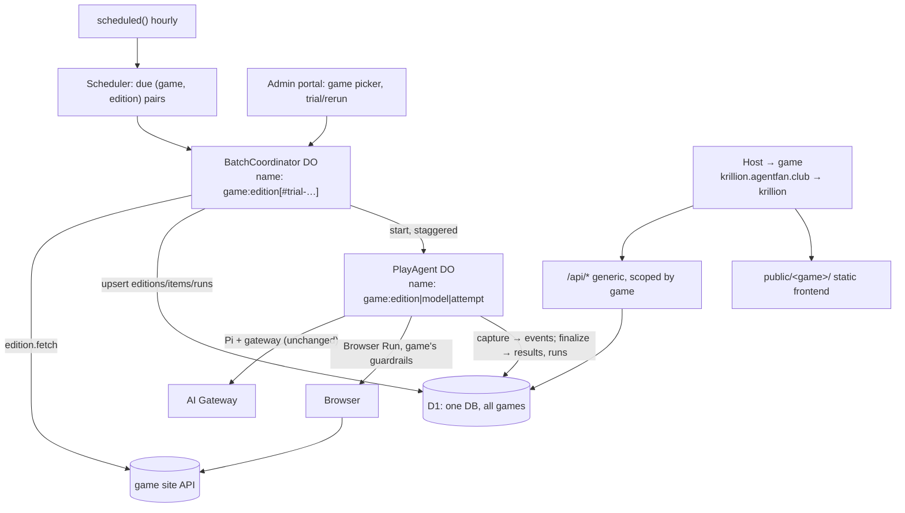

# agentfan arcade — multi-game framework design

Goal: turn krillion-bench into a framework where every rostered model plays many browser games, all results land in one D1, and adding a game means writing one game module plus (optionally) its own frontend. Everything that isn't "what this game is and how it scores" stays shared.

Status: proposal. Builds on `docs/DESIGN.md` (krillion-bench as it runs today); nothing here changes the agent loop, model routing, or DO lifecycle mechanics.

## 1. What is Krillion-specific today

Audit of `src/` (3.2k lines). Roughly 80% is already game-agnostic.

| Concern | Where now | Shared or per game |
| --- | --- | --- |
| Model roster, gateway, Gemini patches, Pi harness, retries, nudge loop, run-state machine, finalize-once, infra-vs-model classification | `Roster.ts`, `agent/gateway.ts`, `agent/DiveAgent.ts` | **Shared** (only the nudge text and "done" check are game input) |
| Browser session, reconnect, target-id pinning, page tools (`navigate/snapshot/click/type/press/wait/screenshot`) | `agent/browser.ts` (`RunPage` minus capture), `agent/tools.ts` | **Shared**; allowed domains come from the game |
| Batch orchestration: dispatch, stagger, infra retry once, deadline, force-close, rank | `coordinator.ts` | **Shared**; game supplies edition fetch + limits |
| Cron + ET-midnight DST gate | `worker.ts` | **Shared** scheduler; reset time/zone per game |
| Admin portal, Access auth, edge caching, logging | `http/*`, `Logging.ts`, `public/admin` | **Shared** |
| `/api/today` fetch, `TodayGame`, 7 prompts | `Krillion.ts`, `domain.ts` | **Per game**: edition fetch |
| `/api/submit` capture, `answerEndsAt` clock, `krillion:game:v1` localStorage | `agent/browser.ts` | **Per game**: capture + probe |
| Tier/points, 7-row results, accepted/timed_out/not_reached | `scoring.ts`, `DiveAgent.promptResults` | **Per game**: score |
| `PROMPT`, `NUDGE`, `PROMPT_VERSION` | `agent/prompt.ts` | **Per game** |
| `games`/`prompts`/`submissions`/`results`/`daily_scores` tables | `migrations/` | **Shared** generic tables, game detail in JSON columns |
| Leaderboard page | `public/` | **Per game** frontend on a shared API + shared JS kit |

## 2. Core concepts

| Term | Meaning | Krillion |
| --- | --- | --- |
| **Game** | A module implementing `GameDefinition` | `krillion` |
| **Edition** | One playable instance, keyed by a string. Daily games: the local date. Seeded games: the seed. Static games: a run label | `2026-11-17` (NY date) |
| **Item** | Optional scored sub-unit of an edition (prompt, puzzle, level, round). Games with one final score have none | 7 prompts |
| **Event** | One ground-truth observation the harness captured from the page (never from the model) | one `/api/submit` exchange |
| **Batch** | A coordinator: one game × one edition × a set of models; real (ranked) or trial | `krillion:2026-11-17` |
| **Run** | One model's attempt at a batch | unchanged |
| **Score** | Game-defined number; higher is better unless the game says otherwise. Plus `norm ∈ [0,1]` for cross-game views | sum of tier points, norm = /700 |

## 3. The game contract

One module per game under `src/games/<id>/`. Everything is Effect + Schema, same conventions as today: each game owns its schemas, every external value is decoded.

```ts
// src/framework/Game.ts
export interface GameDefinition<Ed, Ev> {
  readonly id: GameId                         // "krillion"; stable, used in DO names, D1, URLs
  readonly label: string
  readonly version: string                    // bump on prompt/capture/score change; stored on every run (replaces PROMPT_VERSION)

  // ── where and when ──
  readonly browser: {
    readonly allowedDomains: ReadonlyArray<string>   // Browser Run guardrails
    readonly startUrl?: string                       // omitted = about:blank, model navigates (Krillion)
    readonly needs?: { readonly vision?: boolean }   // canvas games: models without vision are skipped, not run
  }
  readonly schedule: Daily | Manual                  // Daily { zone: "America/New_York", at: "00:05", graceMs }
  readonly limits: { runWallMs; maxTurns; maxNudges; batchDeadlineMs; retry }

  // ── what the edition is (orchestrator side, never seen by the model) ──
  readonly edition: {
    readonly schema: Schema.Codec<Ed>                // stored as editions.raw_json, handed to every run
    readonly fetch: (key: EditionKey) => Effect<Ed, GameError, HttpClient>  // must reject a stale edition (site not rolled over)
    readonly items: (ed: Ed) => ReadonlyArray<Item>  // [] for single-score games
    readonly ordinal?: (ed: Ed) => number            // "Dive #118"
  }

  // ── the agent's task ──
  readonly prompt: (ed: Ed) => { readonly task: string; readonly nudge: string }

  // ── ground truth, inside the DO, invisible to the model ──
  readonly capture: ReadonlyArray<NetworkCapture<Ev>>     // request matcher + decoder → Ev
  readonly event: Schema.Codec<Ev> & EventColumns<Ev>     // common columns extracted from Ev (itemId, kind, points, clockMs)
  readonly probe: (page: Page, ed: Ed) => Promise<Progress>  // read DOM/localStorage: done?, reached item index, game's own results

  // ── scoring ──
  readonly score: (ed: Ed, events: ReadonlyArray<Ev>, progress: Progress | undefined) => RunScore
  readonly normalize: (score: number, ed: Ed) => number   // → [0,1], for cross-game leaderboards
  readonly direction?: "higher" | "lower"                  // default higher (golf-style games: lower)
}

export interface NetworkCapture<Ev> {
  readonly match: (req: HTTPRequest) => boolean
  /** Read page state as the request leaves (Krillion reads answerEndsAt here). */
  readonly before?: (page: Page) => Promise<unknown>
  readonly decode: (req: HTTPRequest, res: HTTPResponse, before: unknown) => Promise<Option<Ev>>
}

export interface RunScore {
  readonly score: number
  readonly items: ReadonlyArray<ItemResult>               // exactly one per edition item, always
  readonly metrics: Readonly<Record<string, number>>      // game-specific numbers worth aggregating (accept rate, mean ms, …)
}

export interface ItemResult {
  readonly itemId: string
  readonly outcome: "done" | "missed" | "not_reached"     // common semantics → cross-game completion stats
  readonly points: number
  readonly answer: string | null
  readonly ms: number | null                              // time to done, game's own clock if it has one
  readonly attempts: number
  readonly detail: unknown                                // game JSON: Krillion { tier: "rare" }
}
```

Registry: `src/games/index.ts` exports `Games = { krillion } as const`; `GameId` is the literal union of its keys, so every switch on a game id is exhaustive and a typo is a compile error.

What the shared code does with it:

| Step | Shared code | Calls game |
| --- | --- | --- |
| Scheduler | hourly cron `5 * * * *`; for each enabled daily game, starts `batch(game, edition)` when local time crosses `at` (DST-proof generalization of the current gate) | `schedule` |
| Dispatch | fetch edition with grace/retry, upsert `editions`/`items`, read roster, filter by `needs`, insert runs, staggered start | `edition.fetch`, `items` |
| Run begin | open browser with game's guardrails, go to `startUrl`, set model, submit task | `browser`, `prompt` |
| Capture | `page.on(request/response)` for every `capture`; seq + latency; insert `events` row | `capture`, `event` |
| Watch | wall clock, nudge loop, `probe().done` ends the run | `probe`, `limits` |
| Finalize | stop model, final probe, drain capture, `score()`, write run + results, classify | `score`, `probe` |
| Live view | `score(ed, eventsSoFar, undefined)` for running runs | `score` |
| Rank | counted attempt per model (existing rule), sort by `direction`, store `score` + `normalize()` | `normalize`, `direction` |

Status classification stays shared: "made progress" becomes `events.length > 0` instead of `submissions.length > 0`.

### Krillion as a game module (what moves where)

```
src/games/krillion/
  index.ts       GameDefinition: schedule NY 00:05, allowedDomains ["krillion.io"], limits from today's constants
  edition.ts     TodayGame schema + fetch (today's Krillion.ts)
  capture.ts     /api/submit matcher, SubmitRequest/SubmitResponse, answerEndsAt clock (from agent/browser.ts)
  probe.ts       krillion:game:v1 GameState → Progress
  score.ts       scorePrompt + localStorage fallback (scoring.ts + DiveAgent.promptResults); normalize = score / (100 × items)
  prompt.ts      PROMPT, NUDGE (version → GameDefinition.version)
public/krillion/  today's index.html, app.js, styles.css, fonts
```

## 4. Architecture



- **One Worker, one D1, one pair of DO classes.** `DiveAgent` → `PlayAgent`, `DayCoordinator` → `BatchCoordinator` via `exports.durableObject({ state: "renamed", renamedTo })` tombstones in `cloudflare.config.ts`, shipped with `cf deploy` (keeps existing transcripts). New DO names carry the game prefix; old Krillion objects keep their names and stay readable.
- **Per-game config in KV** `games` (admin-editable): `{ [gameId]: { enabled, models: "all" | ids[], schedule?: override } }`. The global `models` roster stays as is.
- **Global launch limiter.** Today the 400 ms stagger is per coordinator; two games starting the same minute could exceed Browser Run's 3 launches/s. Smallest fix: the scheduler offsets each game's start (`at` minutes differ) and coordinators keep the stagger. A token-bucket DO only if that proves insufficient.

## 5. Data model (D1)

One database. Common columns are typed and indexed; per-game detail is JSON (`raw_json`, `data`, `detail`, `metrics`) that only that game's frontend interprets. Same cost rule as today: every query hits a PK or a listed index.

```sql
CREATE TABLE games (game_id TEXT PRIMARY KEY, label TEXT NOT NULL, first_seen TEXT NOT NULL);

CREATE TABLE editions (
  game_id TEXT NOT NULL, edition TEXT NOT NULL, ordinal INTEGER,
  fetched_at TEXT NOT NULL, status TEXT NOT NULL CHECK (status IN ('running','complete')),
  raw_json TEXT NOT NULL,
  PRIMARY KEY (game_id, edition)
);

CREATE TABLE items (
  game_id TEXT NOT NULL, edition TEXT NOT NULL, item_id TEXT NOT NULL,
  position INTEGER NOT NULL, label TEXT NOT NULL, data TEXT,
  PRIMARY KEY (game_id, edition, item_id)
);

-- models: unchanged.

CREATE TABLE batches (
  batch TEXT PRIMARY KEY, game_id TEXT NOT NULL, edition TEXT,
  trial INTEGER NOT NULL, models TEXT, created_by TEXT, created_at TEXT NOT NULL
);
CREATE INDEX batches_created ON batches(created_at);
CREATE INDEX batches_game_created ON batches(game_id, created_at);

CREATE TABLE runs (
  run_id TEXT PRIMARY KEY, batch TEXT NOT NULL,
  game_id TEXT NOT NULL, edition TEXT NOT NULL, model_id TEXT NOT NULL,
  attempt INTEGER NOT NULL, trial INTEGER NOT NULL,
  status TEXT NOT NULL CHECK (status IN ('queued','running','completed','timed_out','failed','infra_error','aborted')),
  error TEXT,
  game_version TEXT NOT NULL,       -- GameDefinition.version (was prompt_version)
  harness_version TEXT NOT NULL,    -- shared tools/harness version: a tool change affects every game
  model_config TEXT NOT NULL,
  created_at TEXT NOT NULL, started_at TEXT, finished_at TEXT,
  score REAL, metrics TEXT,         -- RunScore.score / metrics (JSON)
  steps INTEGER NOT NULL DEFAULT 0, input_tokens INTEGER NOT NULL DEFAULT 0, output_tokens INTEGER NOT NULL DEFAULT 0,
  cost_usd REAL, browser_session_id TEXT, pi_outcome TEXT, self_report TEXT,
  UNIQUE (batch, model_id, attempt)
);
CREATE INDEX runs_model_game ON runs(model_id, game_id, edition);

CREATE TABLE events (                -- replaces submissions
  run_id TEXT NOT NULL, seq INTEGER NOT NULL,
  game_id TEXT NOT NULL, edition TEXT NOT NULL, item_id TEXT,
  kind TEXT NOT NULL,               -- game vocabulary: accepted/rejected/correction/error, move, guess…
  points REAL, at TEXT NOT NULL, latency_ms INTEGER, clock_ms INTEGER, http_status INTEGER,
  data TEXT NOT NULL,               -- the decoded Ev, encoded with the game's schema
  PRIMARY KEY (run_id, seq)
);

CREATE TABLE results (               -- one row per run × item; always every item
  run_id TEXT NOT NULL, item_id TEXT NOT NULL,
  game_id TEXT NOT NULL, edition TEXT NOT NULL, model_id TEXT NOT NULL,
  outcome TEXT NOT NULL CHECK (outcome IN ('done','missed','not_reached')),
  points REAL NOT NULL DEFAULT 0, answer TEXT, ms INTEGER, attempts INTEGER NOT NULL DEFAULT 0, detail TEXT,
  PRIMARY KEY (run_id, item_id)
);
CREATE INDEX results_edition_item ON results(game_id, edition, item_id);
CREATE INDEX results_model_game ON results(model_id, game_id, edition);

CREATE TABLE scores (                -- replaces daily_scores: one counted run per (game, edition, model)
  game_id TEXT NOT NULL, edition TEXT NOT NULL, model_id TEXT NOT NULL,
  run_id TEXT NOT NULL, score REAL NOT NULL, norm REAL NOT NULL, rank INTEGER NOT NULL,
  PRIMARY KEY (game_id, edition, model_id)
);
CREATE INDEX scores_model ON scores(model_id, game_id, edition);
```

Migration `0003_framework.sql`: create the new tables, backfill from the Krillion ones (`game_id='krillion'`, `accepted→done`, `timed_out→missed`, `tier → detail.tier`, submissions → events with tier/correction/canonical in `data`, `norm = total/700`), drop the old tables. One cutover, no dual writes.

Cross-game aggregation this enables, all index-served:
- Overall model ranking: mean `scores.norm` per model over the last N editions of each enabled game (`scores` PK prefix per game).
- Per-model profile: `scores_model` across games.
- Common behavior stats across games: completion rate (`results.outcome`), cost per normalized point, infra-error rate, self-report vs `runs.score`.

## 6. HTTP API and frontends

Shared, game-scoped endpoints (shapes generic; `detail`/`data`/`metrics` pass through as JSON):

| Endpoint | Returns |
| --- | --- |
| `GET /api/:game/scores?days=N` | ranked `scores` per edition with each run's `results` |
| `GET /api/:game/live` | current edition while it runs: finished results + partial `score()` of running runs |
| `GET /api/:game/editions/:edition` | edition raw JSON, items, runs |
| `GET /api/overall?days=N` | cross-game normalized leaderboard |
| `/admin/api/*` | as today plus `game` on start/rerun/batches, and `GET/PUT /games` (KV `games`) |

Frontends: `public/<game>/` per game, free to look like anything. The Worker maps hostname → game (`krillion.agentfan.club → krillion`, a table in code) and serves `public/<game>/…`, so each game page fetches `/api/scores` on its own host and the Worker scopes it. A shared `public/_kit/` (fetch + live-poll helper, ranking table, score-spread chart already in `app.js`) keeps a new frontend to a page of game-specific rendering. `public/index.html` on the bare host becomes the overall arcade board.

## 7. Adding a game: the whole checklist

1. `src/games/<id>/`: edition fetch (or none), prompt, capture, probe, score, normalize. Add to `Games`.
2. Play one round by hand in headless Chromium, as was done for Krillion (DESIGN.md §1): find the submit endpoint, the client state, the done signal. Write that down as the game's facts table.
3. `public/<id>/` frontend; hostname entry.
4. Admin: run a trial batch for 2–3 models, check events/results in D1, then enable the schedule.

No migration, no new DO class, no new binding.

## 8. Game shapes this must survive

| Shape | Example | Fits how |
| --- | --- | --- |
| Daily, network-scored, items | Krillion, daily trivia | as designed |
| Daily, client-scored | Wordle-likes that grade in JS | no `capture`; `probe` reads the board/storage; score from probe; `events` empty or from DOM mutation probes |
| Single final score, no items | 2048, endless runner | `items` `[]`, `score` from probe; seeded edition if the site supports seeds, else `Manual` + repeated attempts |
| Canvas, no DOM | arcade games | `needs.vision`; add one shared tool `click_at(x, y)` (screenshot-coordinate click), counted in `harness_version` |
| Lower is better | golf/time trials | `direction: "lower"`; `normalize` maps to higher-is-better |

Not supported without more design: multiplayer/turn-based against other agents, games needing login.

## 9. Delivery plan

| Phase | Change | Done when |
| --- | --- | --- |
| 1. Extract | `src/framework/` (Game contract, PlayAgent, BatchCoordinator, capture plumbing), Krillion moved into `src/games/krillion/`. D1 untouched (Krillion writes through an adapter to old tables) | a Krillion trial run produces identical rows to today |
| 2. Generic data | migration 0003 + backfill, `Database` on generic tables, `/api/:game/*`, Krillion frontend on the generic shapes | live site unchanged visually, data backfilled |
| 3. Multi-game ops | hourly scheduler, KV `games`, admin game picker, host→game routing, DO renames | admin can trial any registered game |
| 4. Second game | pick one structurally different from Krillion (client-scored or single-score) | proves contract; adjust it before game 3 |

Phase 1 alone is a pure refactor and can ship any day; phases 2–3 are the one cutover that touches stored data.

## 10. Open decisions

| # | Decision | Options | Recommendation |
| --- | --- | --- | --- |
| 1 | Deploy shape | one Worker for all games / Worker per game sharing a D1 | One Worker: one deploy, shared runtime, the only cost is coupled deploys |
| 2 | Second game | which site | Something client-scored or single-score, to stress the contract |
| 3 | Cross-game normalization | `score / max` per game / percentile among models that edition / z-score | `score / max` where a max exists; percentile for unbounded games (game picks via `normalize`) |
| 4 | Branding / hosts | `<game>.agentfan.club` each via Cloudflare for SaaS (as Krillion) / one host with `/<game>` paths | subdomain per game: matches today's Krillion setup |
| 5 | Roster per game | global roster + per-game subset in KV / fully separate rosters | global + subset |
